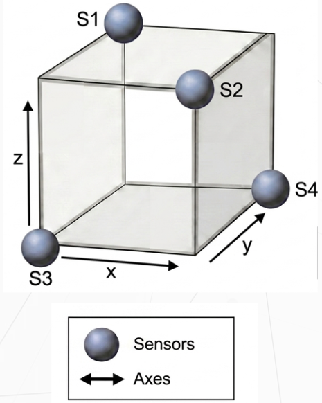
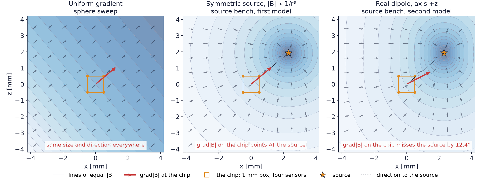
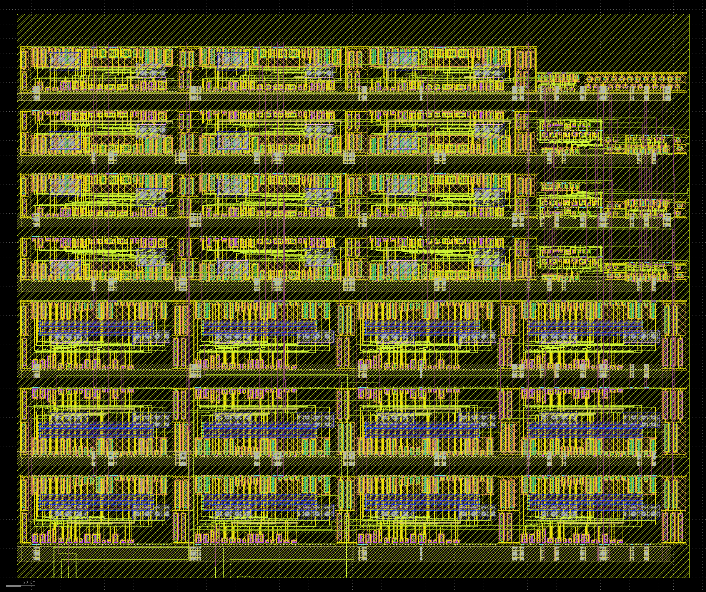
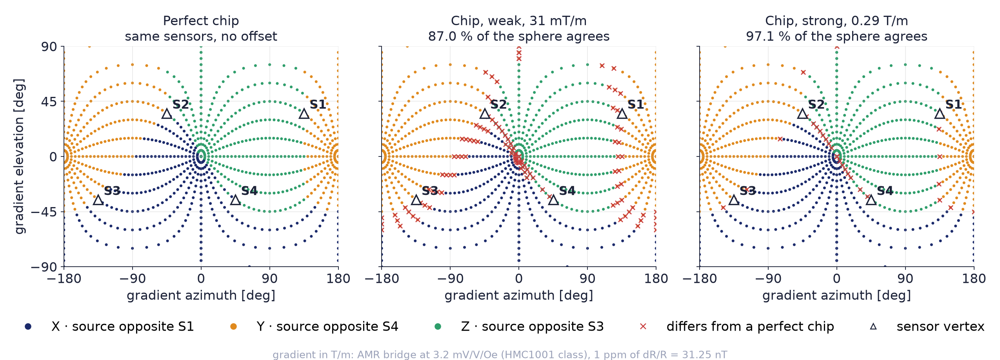
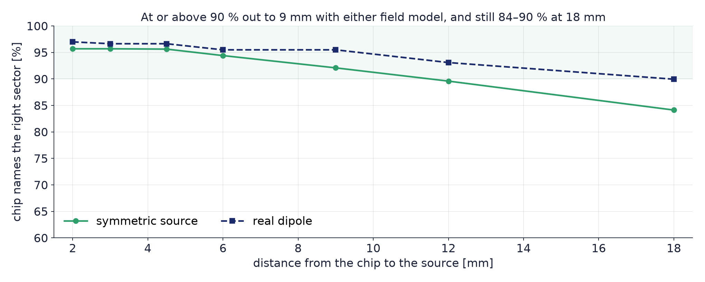

# Magnetic Gradient Navigation and Control IC

**SSCS Chipathon 2026 · Team B26 Zotnetic · UC Irvine · GF180MCU (180 nm, open-source PDK)**

A mixed-signal chip that tells **on which side a magnet is**, using four
magnetoresistive bridges that only measure the **magnitude** of the field |B|.
The sensor that reads the least is the one furthest from the source; the chip
finds it with analog circuits only — no ADC, no processor — and raises one of
three digital pins.

| | |
|---|---|
|  |  |
| Four sensors on the vertices of a tetrahedron | What the sensors see: uniform gradient, point source, real dipole |

## How it works

```
4 AMR bridges ──► 4 sensing chains ──► 3 analog vote counters ──► XP  YP  ZP
 (|B| at each     (amplify 3 readings,   (current-mode sum,
  vertex)          compare pairwise,       2 of 4 votes claims
                   decoder votes)          the output)
```

* **GRADIENT2** (×4): three 40 dB amplifiers, three comparators and a decoder.
  Each chain reads three of the four sensors and votes for the smallest.
* **WEIGHT + COMP_OUT** (×3): add the four votes and drive a digital pad.
* **The key decision is the wiring.** S1 always enters the X slot, S4 the Y slot
  and S3 the Z slot, so the three chains that see the furthest sensor vote
  together (3-0-0). The "obvious" rotated wiring makes them cancel (1-1-1) and
  its output carries no information about the source.
* **Reading the pins:** `XP` = source opposite S1, `YP` = opposite S4,
  `ZP` = opposite S3. They name a *sector*, not an axis in space.
  `XN` `YN` `ZN` are their complements; `X` `Y` `Z` bring the vote sums out
  as analog test points.

| Item | Value |
|---|---|
| Top cell / GDS | `B26_A` · `FINAL/openroad/out_integration/B26_A_filled4.gds` |
| Navigator core | `GRADIENT_NAV2_V3`, 460.9 × 387.0 µm |
| Supply / power | 5.0 V · ~74 mW |
| Pins | 19: S1P…S4N (8 analog sensor inputs), X Y Z (3 analog test points), XP XN YP YN ZP ZN (6 digital outputs), VDD, VSS |
| Pin list | [`info.yaml`](info.yaml) · export control: [`documents/`](documents/) |



## Simulation testing — where everything is

Every bench is an xschem testbench plus a shell script that runs ngspice, and
a Python script that turns the raw output into a CSV and figures. **Every result
compares the schematic against the layout extracted with RC parasitics.**

| Level | What it checks | Run | Data / figures |
|---|---|---|---|
| Blocks | OPAM_LIN, COMP, DECODER, WEIGHT: DC, AC, transient, slew, noise, Monte Carlo | `FINAL/XSCHEM/TEST/run_*.sh` | `FINAL/XSCHEM/TEST/simulation/`, `FINAL/reportes/figuras/blk_*.png` |
| One chain | GRADIENT2 across a full 360° field turn, linear and saturated | `FINAL/XSCHEM/TEST_TOTAL/run_gradient.sh` | `FINAL/reportes/figuras/grad_*.png` |
| Full navigator | 721-point sweep, 6 digital outputs, schematic vs layout (99.58 % agreement) | `FINAL/XSCHEM_v3/run_nav3.sh` | `FINAL/XSCHEM_v3/datos_nav3/` |
| Every direction | Uniform gradient over the whole sphere (13 planes × 73 directions), 3 gradient levels, 200 ppm sensor mismatch | `FINAL/XSCHEM_v3/run_nav3_geo.sh` | `FINAL/XSCHEM_v3/datos_geo_v3/` |
| A real magnet | Point source and dipole, 7 distances (2–18 mm) × 4 planes | `FINAL/XSCHEM_v3/run_fuente3.sh` | `FINAL/XSCHEM_v3/datos_fuente_v3/` |

`datos_geo_v3/` and `datos_fuente_v3/` each hold a `manifiesto.csv` (one row per sweep and its
parameters), `vectores.txt` (the signals saved) and `por_barrido/s###.csv`
(one CSV per sweep: stimulus, the four bridge readings, every internal vote
and the six output pins). The analysis scripts next to each bench
(`analizar_*.py`) recompute every number from those files.

### Main results

| | |
|---|---|
|  |  |
| Pin raised over the whole sphere vs. a perfect chip: **97.1 %** agreement at 0.29 T/m, 87.0 % at 31 mT/m | Right sector vs. magnet distance: **95.7 %** at 3 mm, 89.6 % at 12 mm, never undecided |

Physical verification: `B26_A_filled4` is DRC clean on the GF180MCU KLayout
sign-off deck (deep mode, with and without connectivity) and LVS clean
(netgen, *"Circuits match uniquely"*).

### Reproducing a sweep

Inside the IIC-OSIC-TOOLS container (setup: [`docs/CHIPATHON_TEMPLATE_README.md`](docs/CHIPATHON_TEMPLATE_README.md)):

```bash
cd /foss/designs/<this repo>/FINAL/XSCHEM_v3
./run_nav3_geo.sh 5          # sphere sweep, 5° step  -> datos_geo_v3/
./run_fuente3.sh 5           # magnet around the chip -> datos_fuente_v3/
```

## Lab testing plan (after fabrication)

The silicon is tested with the **same stimuli and the same CSV format** as the
simulations, so every measurement lands next to its simulated counterpart.

1. **Bring-up.** 5.0 V supply, current draw against the simulated ~15 mA;
   bridges balanced → the pins must hold a valid code (exactly one of XP/YP/ZP high).
2. **Replay the simulation (no magnet).** Replace the four AMR bridges with
   DAC-driven resistive bridges and play back the bridge readings stored in
   `datos_geo_v3/por_barrido/` and `datos_fuente_v3/por_barrido/`. The pins
   recorded by a logic analyzer are compared, sample by sample, with the
   simulated ones. This isolates the chip from the sensors.
3. **Uniform gradient.** Real AMR bridges on the tetrahedron fixture inside a
   gradient coil pair; rotate the fixture through the same planes as the
   sphere sweep.
4. **A magnet.** A permanent magnet moved by a motorized stage around the
   fixture at 2–18 mm, as in the source bench; compare the right-sector rate
   against the simulated curve.

Measured data will be stored under `FINAL/measurements/` with one
`manifiesto.csv` per campaign and one CSV per sweep, using the same columns as
the simulation, so the existing `analizar_*.py` scripts process both.

## Repository map

| Path | Contents |
|---|---|
| `FINAL/XSCHEM`, `XSCHEM_v2`, `XSCHEM_v3` | Schematics and testbenches (`v3` = the wiring that ships) |
| `FINAL/layouts_v2` | Hand-drawn block layouts (Magic/KLayout) |
| `FINAL/openroad` | OpenROAD placement, routing, integration, DRC and LVS scripts |
| `FINAL/reportes` | Figures and design report decks |
| `info.yaml`, `lvs_config.json` | Chipathon submission interface |
| `documents/` | GF export-control form |

Team: Juan Sánchez (lead), An Bui, Enzo Li, Akam Khinda, Aysha Hussaini.
License: Apache-2.0 ([LICENSE](LICENSE)).
